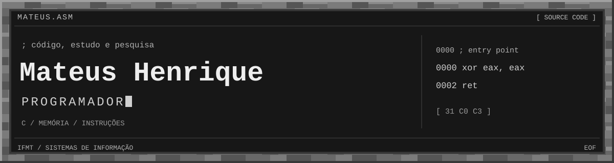

  

### Sobre mim

Sou Mateus Henrique, programador e estudante do bacharelado em Sistemas de Informação no Instituto Federal de Mato Grosso (IFMT), Campus Pontes e Lacerda. Também desenvolvo pesquisas científicas durante a graduação.

### Stack

  
  
  
  
  

  
  
  

---

[LinkedIn](https://www.linkedin.com/in/mateushgds75/) · [Repositórios](https://github.com/teus123321?tab=repositories)
